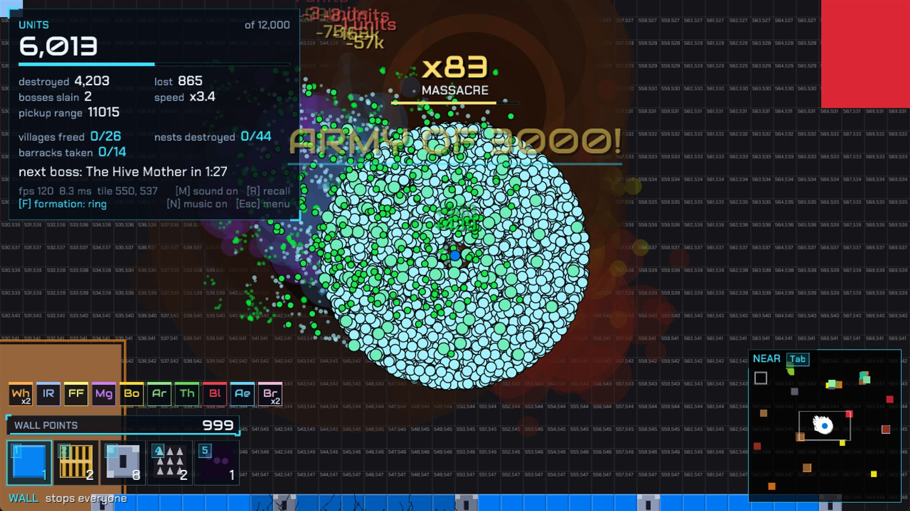
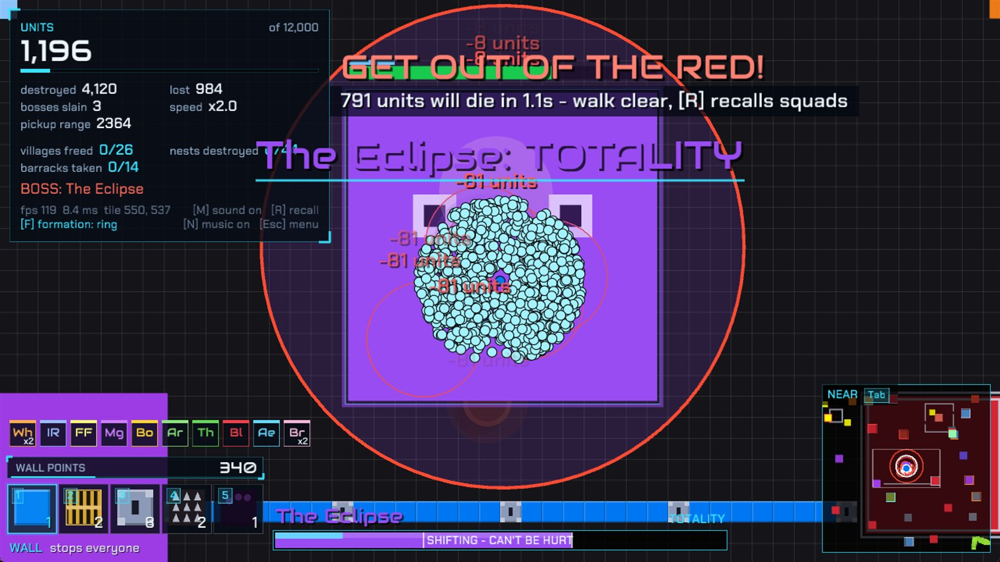
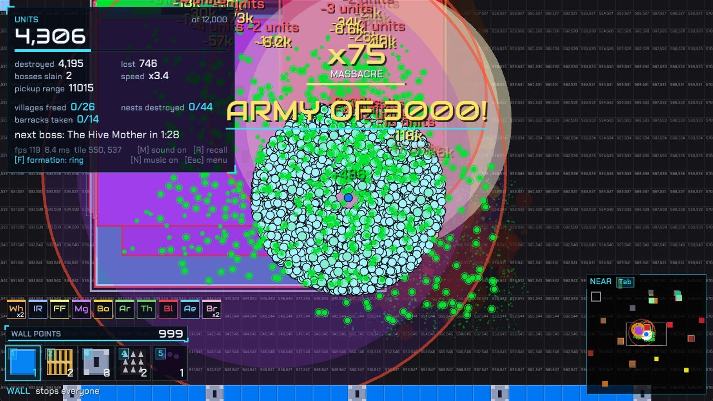
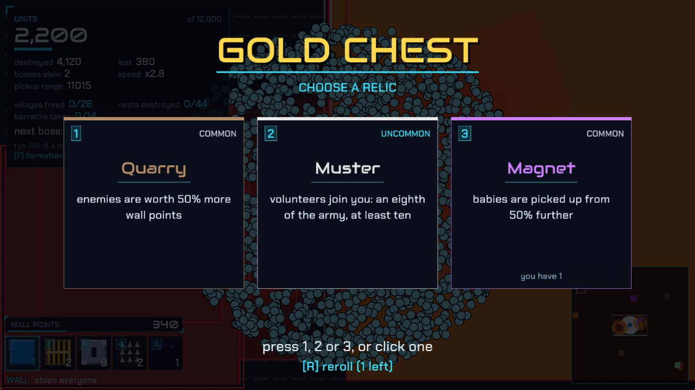
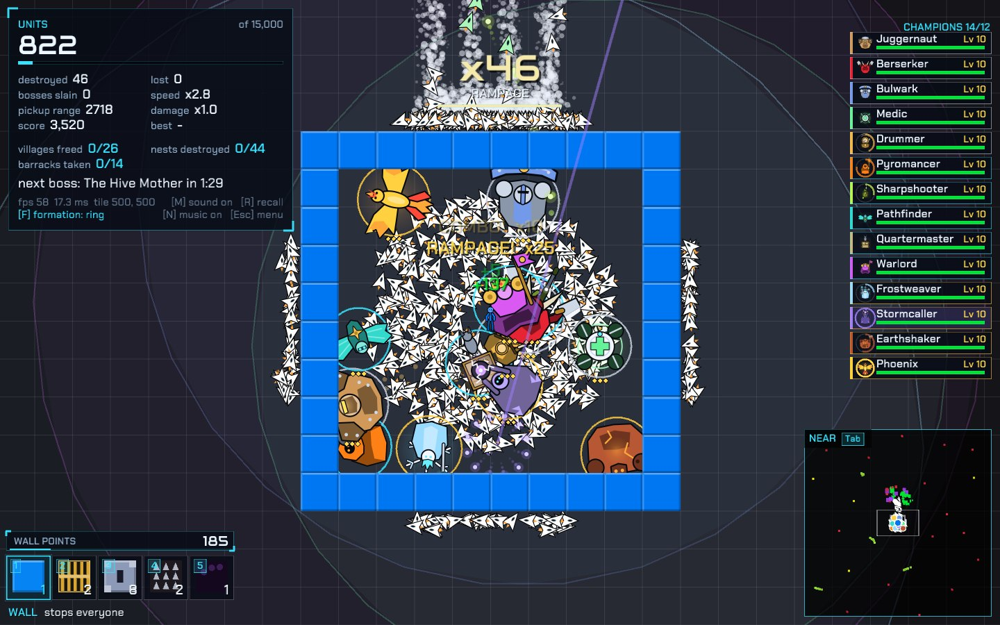

# The Army

A top-down game about a growing army, alone or with up to three others over the internet. You are one little runner at the centre of a few thousand of them, and the world is a
1000 x 1000 tile field full of things that want to stop you: nests, raiding hordes, and eight bosses (the last one, the Sovereign,
comes back after you fell it). Pick up the babies that enemies drop, grow the army to the thousands, point it at whatever is
in the way, and wall in whatever you can't fight.

Written in Rust with [macroquad](https://macroquad.rs). Every sound and the music are synthesised in code, so the only assets
are the fonts.



## What you do

- **Grow.** Enemies drop babies, villages are freed into more army, and barracks you take send recruits and sometimes a champion.
  The army fights on its own around you. Walk where you want it to be.
- **Send squads.** Click an enemy to send part of the army at it, sized to what it takes to win. `R` recalls them. Three
  formations (`F`) change how the rest of the army follows you: a ring with you safe in the middle (the usual one), a wedge, or a line.
  Playing alone there is also *Free*, where the units just pile up on you; in a hosted or joined game that one is left out, as it costs too much with several armies.
- **Survive bosses.** Seven bosses with several phases each, plus the Sovereign. They raise barriers, call meteors, charge,
  slam and mark the ground in red. When you hear "get out of the red", walk. Slaying one gives you a choice of relics.
  A boss makes an entrance: the camera goes to it and back, with its name across the screen (`Space` skips it). Playing alone the
  world crawls meanwhile; with others it can't be slowed for one of you, so you keep steering and the entrance ends early if your army is in trouble.
- **Break hordes.** Hordes (Swarm Tide, Iron Column, Wildfire, Stampede, Titan March and more) are announced on screen and
  an arrow shows where they come from. Break one and it drops a bronze, silver or gold chest: wall points, recruits, a
  champion and, from gold, a choice of relic.
- **Collect champions.** Fourteen special units won as loot, each drawn as itself: Juggernaut, Medic, Pyromancer, Stormcaller,
  Phoenix, Frostweaver and eight more, each with a power of its own that is a share of what the whole army does. Kills and a second
  of a kind raise its level, up to 10; the shooters fire longer bursts, rings and spirals as they rise, and at level 10 you choose its
  final form, once. The roster on the right shows each one's power coming round; click a row to find it in the world.
- **The front fires.** The front of the army shoots ahead of it, the way it is going, at what is there (never behind), and sees
  further the bigger the army grows, about the width of the screen at 10,000 units.
- **Build.** Earn wall points by destroying enemies, then spend them on walls, gates, towers you can man, spikes and tar.
  Enemies path around what you build, and walls decide where a fight happens.
- **Pick relics.** Whetstone, Iron Resolve, Magnet, Quarry, Muster, Bloodlust, Aegis, Freezing (frozen enemies shatter in a burst of frost), Volley Drill, Chain Shot, Tracer Rounds and many more stack across the run.
- **Combos.** Chain kills for a MASSACRE, then a RAMPAGE, and watch the numbers climb.

The game is built for a lot of units: 15,000 by default (the settings take it anywhere from 5,000 to 50,000), drawn as instanced ships (small darts that point the way they are going, drawn in the shader, with plain
circles as a setting) with the army's work shared over all your processor cores. It runs at your display's refresh rate (it was developed on a 120 Hz screen).

You are a stick figure that runs: facing you going down, showing its back going up, in profile going across, and shrinking to a plain dot when the view is zoomed far out.

| | |
|---|---|
|  |  |
| The Eclipse, one of seven bosses | A MASSACRE combo with three hordes closing in |





## Controls

| Key | Does |
|---|---|
| `W A S D` | move |
| mouse wheel | zoom |
| click an enemy | send a squad |
| `R` | recall the squads |
| `F` | change the formation |
| click, drag | build walls |
| right click | delete a wall |
| `1` - `5` | what to build |
| `G` | man a tower |
| `Tab` | minimap: near or world |
| `M` / `N` | mute / music on or off |
| `F5` / `F9` | quick save / quick load |
| `F11` | fullscreen on or off (the game always starts fullscreen) |
| `Space` | skip a boss's entrance |
| `1 2 3` | choose a relic |
| `1 2` | choose a champion's final form, at level 10 |
| click a champion in the roster | find it in the world |
| `Esc` | menu (settings, controls, save, load) |

The game also saves on its own, and the title screen offers to carry on from where you left off.

## Playing with others

Up to four players share one world over the internet. One of you hosts: the host's game runs the world, and everyone else sees and plays in it
with their own army of up to 12,500 units, their own relics and their own walls. Each player's colour tints their army, their names float over
them, and an arrow at the edge of the screen points at whoever is off it. Nothing is needed but the host's password: games are found on the lobby list, and nobody types or sees an address.

**Hosting.** Press `M` on the title screen for *Multiplayer*, then *Host a game*: pick your name, a password (4 characters or more) and a port (47821 unless you
change it), and *Start hosting*. Your game goes on the lobby list (below) so that friends can find it. Friends who join appear in the lobby; press *New run* (or *Continue party*, below) when everyone is in. Players can still join after the run has started.

- **Forward the port.** The game uses **UDP**, not TCP. On your router, forward UDP port 47821 (or the port you chose) to the machine that is hosting.
  Friends then find your game on the lobby list. Without the forward, only a second window on the same computer can join (*Join local*, below).
- **Firewall.** The first time you host, Windows asks whether to let the game through its firewall: allow it (private networks is enough for the same network,
  tick public for the internet). On Linux, open the port, for example `sudo ufw allow 47821/udp`.
- **The password** is never sent: a joiner proves they know it, and the host keeps no more of it than that proof needs. The connection is encrypted, but it can't prove it is the
  host you meant (there is no certificate authority for it), so use a password you do not use anywhere else.

**Joining.** `M` on the title screen, then *Join a game*: give your name and press *Find games*, pick a game from the list, and type its password. There is no address to type, and none is shown.

**Join local.** To try the game out, or to play two at one computer, host in one window and choose *Join local* in the other: it joins a game hosted on this computer by its port (47821 unless the host chose another), with the name and password.

**Coming and going.** A player who drops (or closes the game) has their army held where it was, out of reach of everything, and shows as AWAY in the list.
Joining again with the same name gets it back, and a guest whose connection is lost tries to rejoin for a minute by itself. The host saves the whole party
(`F5`, the menu, or on its own); next time the host's lobby offers *Continue party*, and each friend takes their army up again by joining with their name.
Only the host saves and loads. If the host ends the game, it ends for everyone.

**The lobby list.** Every hosted game is on a list of open games, and every other player joins from it. It is a tiny web service (in [`lobby-server`](lobby-server/README.md),
written for Vercel and a free Redis database) that only holds the list: the games themselves are still played straight with the host. The game already knows where it is,
so there is nothing to set up. [`lobby-server/README.md`](lobby-server/README.md) has the steps to run a list of your own.

## Download

Builds for Windows and Linux are attached to each
[release](https://github.com/flooyd/thearmy/releases). They need nothing installed.

**Windows:** unzip it and run `TheArmy.exe`. Windows may say "Windows protected your PC" because the program isn't
signed. Click "More info", then "Run anyway". (Or right-click the zip, choose Properties, tick Unblock, and extract it after that.)

**Linux:** extract the tarball and run `./TheArmy`. It needs the usual desktop libraries; on Arch and CachyOS:

```sh
sudo pacman -S --needed alsa-lib libx11 libxi mesa
```

Saves and settings live in `%APPDATA%\TheArmy` on Windows and `~/.local/share/TheArmy` on Linux.

## Build from source

You need [Rust](https://rustup.rs) (edition 2024, so a recent stable toolchain).

```sh
cargo run --release
```

On Linux you also need the development libraries:

```sh
# Debian / Ubuntu
sudo apt install libasound2-dev libx11-dev libxi-dev libgl1-mesa-dev pkg-config
```

Use `--release`: a debug build is much slower with thousands of units. Set `THE_ARMY_WINDOWED=1` to start in a window
instead of filling the screen.

```sh
cargo test --release
```

The multiplayer tests open real connections on this machine (they need loopback networking, nothing else).

The code is one file for each part of the game; `src/main.rs` has the map of them, and every tuning constant is in
`src/config.rs`. Pushing a tag like `v0.1.0` makes GitHub Actions build the Windows and Linux downloads and publish a release.

## Credits

The fonts are [Audiowide](https://fonts.google.com/specimen/Audiowide) and
[Chakra Petch](https://fonts.google.com/specimen/Chakra+Petch), both under the SIL Open Font License (the licenses are in
`assets/fonts`).
